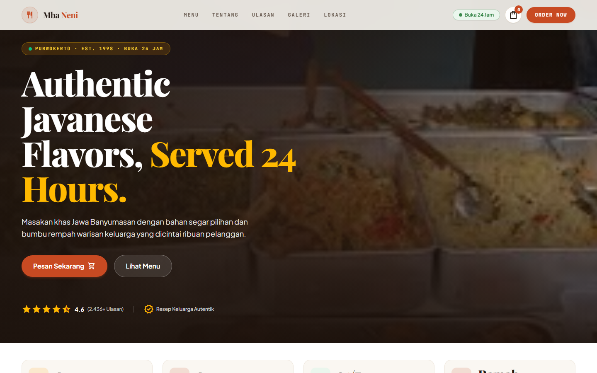
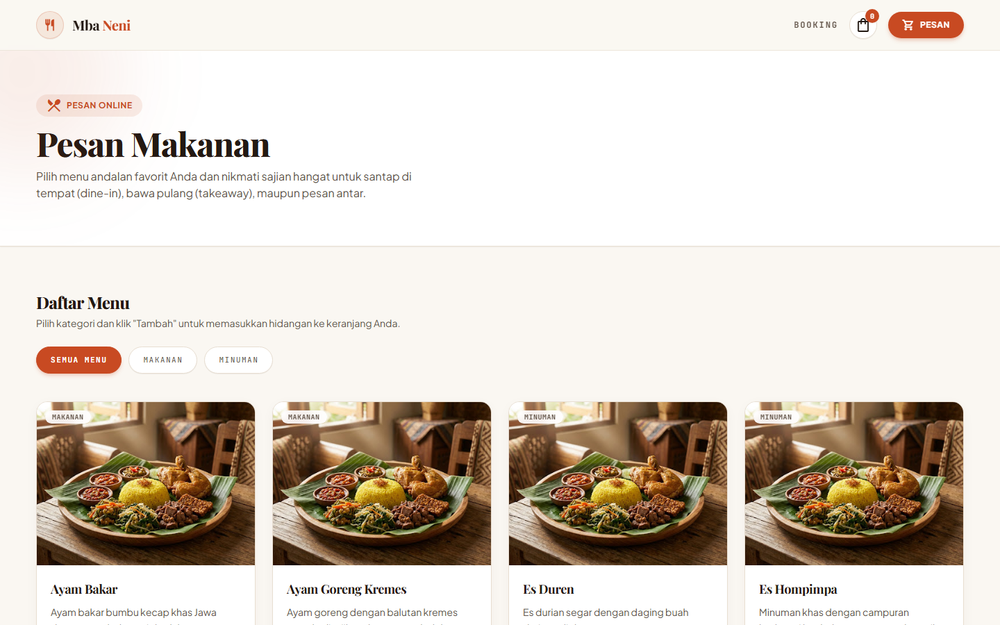
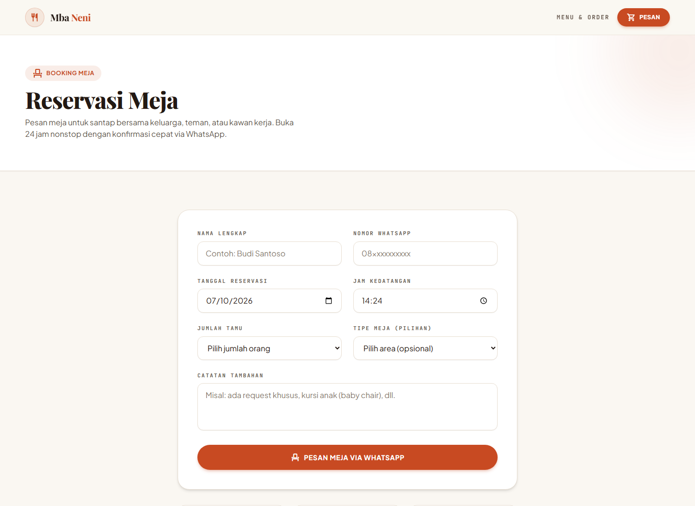
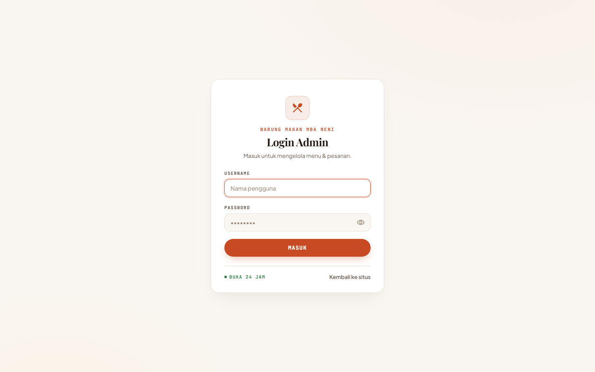
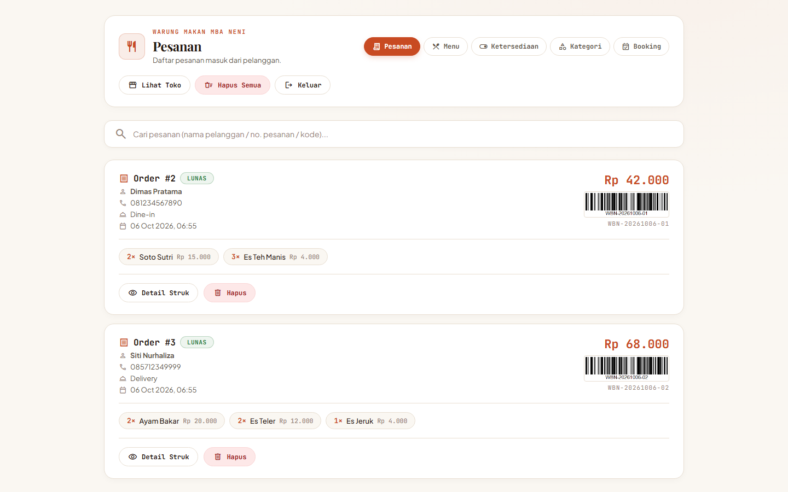
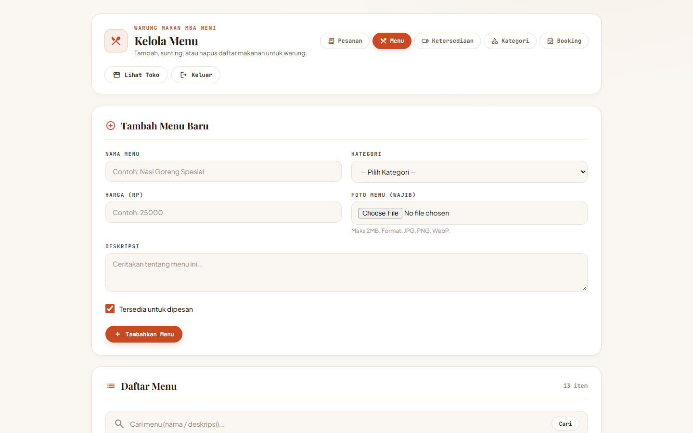
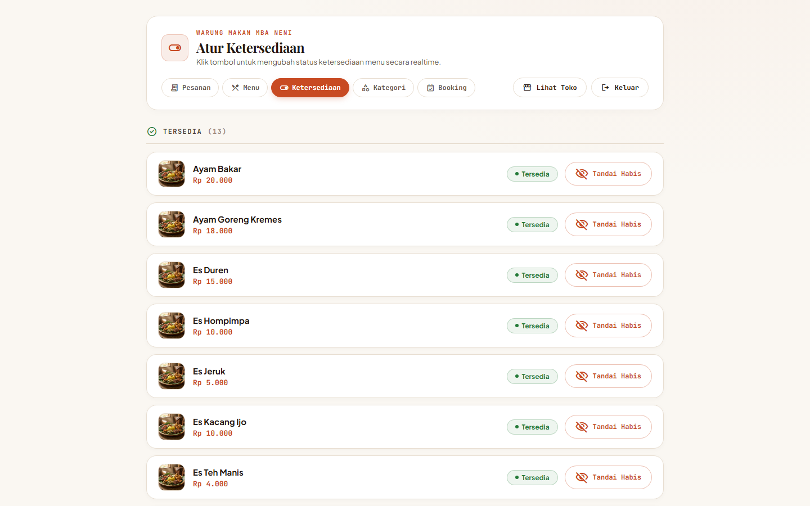
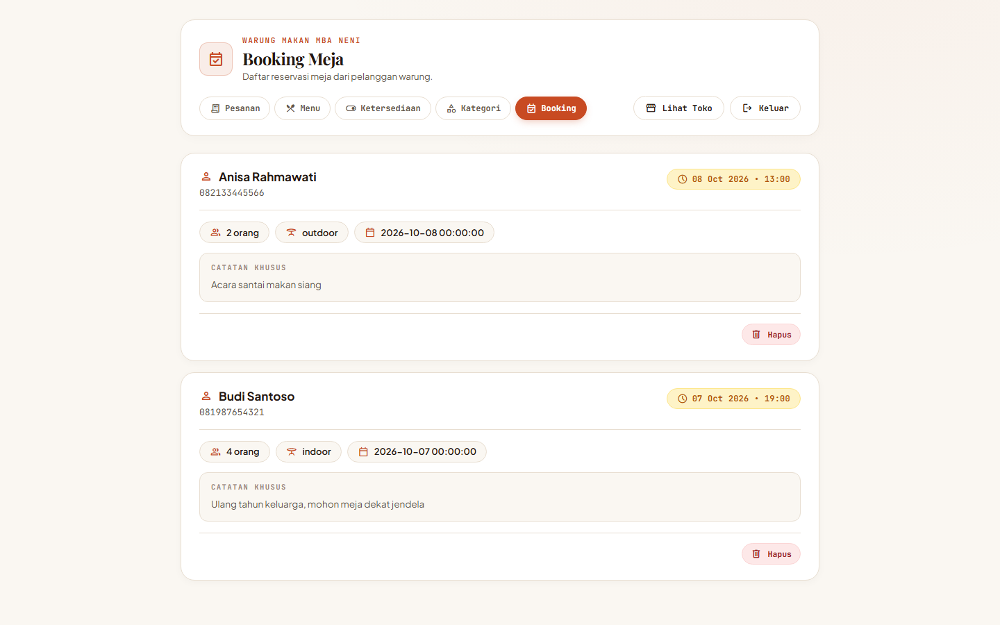
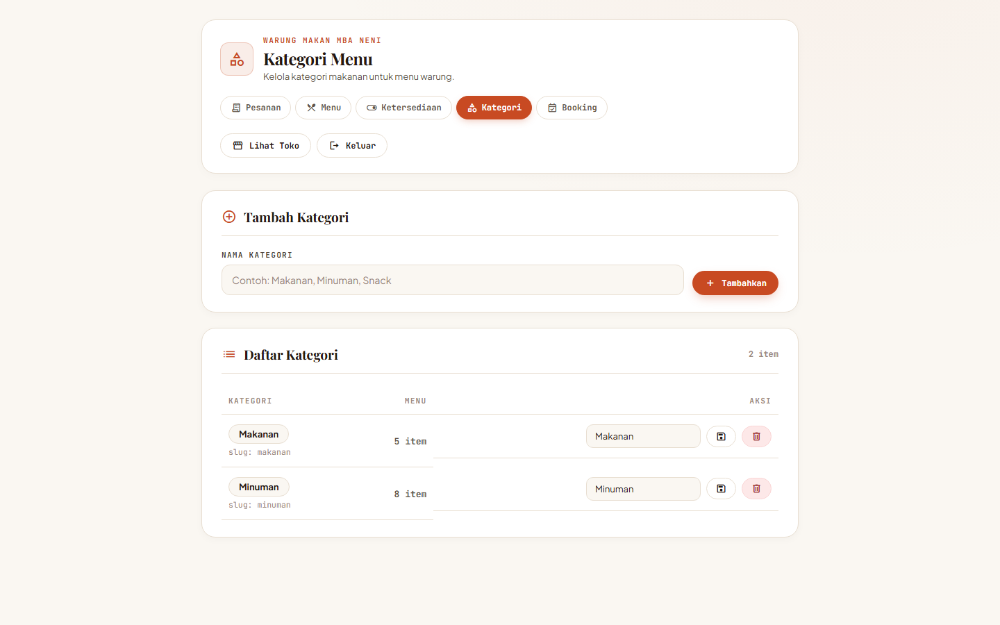

# 🍲 Warung Makan Mba Neni — Web Application

> Sistem Web Pemesanan Makanan Online, Reservasi Meja, dan Manajemen Warung Makan Berbasis **Laravel 13**, **Tailwind CSS**, dan **SQLite**.

---

## 📸 Screenshots Showcase

### 1. Halaman Publik (Customer Facing)

| Landing Page (Beranda) | Menu & Pemesanan Online |
|:---:|:---:|
|  |  |

| Reservasi Meja (Booking) | Login Admin Portal |
|:---:|:---:|
|  |  |

---

### 2. Panel Admin (Management Dashboard)

| Manajemen Pesanan (Orders) | Kelola Menu & Produk |
|:---:|:---:|
|  |  |

| Pengaturan Ketersediaan (Stok Menu) | Manajemen Booking Meja |
|:---:|:---:|
|  |  |

| Kelola Kategori Menu |
|:---:|
|  |

---

## ✨ Fitur Utama

- 🏮 **Desain Estetika Kuliner Nusantara (Warm Culinary Aesthetic):**
  - Tema hangat berbasis nuansa krem (*cream/parchment*), oranye bata (*terracotta*), dan aksen hijau rempah.
  - Tipografi elegan kombinasi *Playfair Display*, *Plus Jakarta Sans*, dan *JetBrains Mono*.
- 🛒 **Pemesanan Makanan Online:**
  - Keranjang belanja interaktif realtime.
  - Pilihan layanan: Dine-in (Makan di Tempat), Takeaway (Bungkus), dan Delivery (Antar).
  - Integrasi nomor WhatsApp dan kode referensi unik pesanan.
- 📅 **Reservasi Meja (Table Booking):**
  - Formulir pemesanan meja dengan pilihan area (Indoor/Outdoor), tanggal, jam, dan jumlah tamu.
  - Konfirmasi pemesanan cepat via WhatsApp warung.
- 🔐 **Admin Dashboard Lengkap:**
  - **Pesanan:** Monitoring pesanan masuk, rincian struk belanja, dan barcode transaksi.
  - **Menu:** Tambah, edit, dan hapus menu makanan/minuman dengan foto hidangan.
  - **Ketersediaan:** Toggle cepat status menu (Tersedia / Habis) secara instan.
  - **Kategori:** Manajemen kategori makanan & minuman.
  - **Booking:** Daftar jadwal reservasi meja dan catatan khusus pelanggan.

---

## 🛠️ Tech Stack

- **Backend:** Laravel 13, PHP 8.3+
- **Database:** SQLite (default) / MySQL ready
- **Frontend:** Blade Templates, Tailwind CSS, Alpine.js, Vite
- **Icons & Fonts:** Google Material Symbols, Playfair Display, Plus Jakarta Sans, JetBrains Mono

---

## 🚀 Panduan Instalasi & Menjalankan Proyek

### 1. Clone Repositori
```bash
git clone https://github.com/rulipanji3/webrestorant.git
cd webrestorant
```

### 2. Install Dependensi PHP & JavaScript
```bash
composer install
npm install
```

### 3. Konfigurasi Environment (.env)
```bash
cp .env.example .env
php artisan key:generate
```

### 4. Migrasi & Seed Database
```bash
php artisan migrate --seed
php artisan db:seed --class=DemoDataSeeder
```

### 5. Kompilasi Aset Frontend
```bash
npm run build
```

### 6. Jalankan Server Lokal
```bash
php artisan serve
```
Buka browser dan akses [http://127.0.0.1:8000](http://127.0.0.1:8000).

---

## 🔑 Kredensial Default Admin

- **URL:** [http://127.0.0.1:8000/admin/login](http://127.0.0.1:8000/admin/login)
- **Username:** `admin`
- **Password:** `secret`

---

## 🧪 Menjalankan Pengujian (Testing)

```bash
php artisan test
```

Semua unit & feature test siap dijalankan dengan SQLite in-memory database:
```
PASS  Tests\Unit\ExampleTest
PASS  Tests\Feature\AdminPagesTest
PASS  Tests\Feature\CheckoutTest
PASS  Tests\Feature\ExampleTest
PASS  Tests\Feature\WarungMakanPageTest
Tests: 7 passed (25 assertions)
```

---

## 📄 Lisensi

Proyek ini dilisensikan di bawah [MIT License](LICENSE).
