# 📐 Dokumentasi Diagram UML — Warung Makan Mba Neni
*(Visual Paradigm Standard & Mermaid Architecture)*

Dokumen ini memuat rancangan pemodelan perangkat lunak berstandar **UML (Unified Modeling Language)** untuk sistem **Warung Makan Mba Neni** (Laravel 13 & Tailwind CSS). Rancangan ini dirancang agar kompatibel dengan **Visual Paradigm** (baik desktop maupun [Visual Paradigm Online](https://online.visual-paradigm.com/app/diagrams/)).

---

## 📋 Daftar Isi
1. [Use Case Diagram](#1-use-case-diagram)
2. [Class Diagram](#2-class-diagram)
3. [Sequence Diagram](#3-sequence-diagram)
   - 3.1 Sequence: Pemesanan Makanan Online (*Customer Checkout*)
   - 3.2 Sequence: Reservasi Meja (*Table Booking*)
   - 3.3 Sequence: Toggle Ketersediaan Menu (*Admin Realtime Availability*)
4. [Activity Diagram](#4-activity-diagram)
   - 4.1 Activity: Alur Pemesanan Makanan Online (*Customer Flow*)
   - 4.2 Activity: Alur Reservasi Meja (*Booking Flow*)
   - 4.3 Activity: Alur Otentikasi & Manajemen Menu (*Admin Flow*)
5. [Kode PlantUML untuk Visual Paradigm Import](#5-kode-plantuml-untuk-visual-paradigm-online-import)

---

## 1. Use Case Diagram

Diagram ini mendefinisikan fungsionalitas sistem dari sudut pandang aktor:
- **Pelanggan (Customer)**: Pengunjung warung yang dapat melihat menu, melakukan pemesanan (dine-in, takeaway, delivery), dan melakukan reservasi meja.
- **Admin Warung**: Pengelola yang mengelola pesanan masuk, ketersediaan menu secara realtime, katalog hidangan, kategori, dan daftar reservasi.
- **Sistem Eksternal (WhatsApp / Mailer)**: Layanan perantara untuk notifikasi dan konfirmasi pemesanan.

### Visualisasi Diagram (Mermaid)

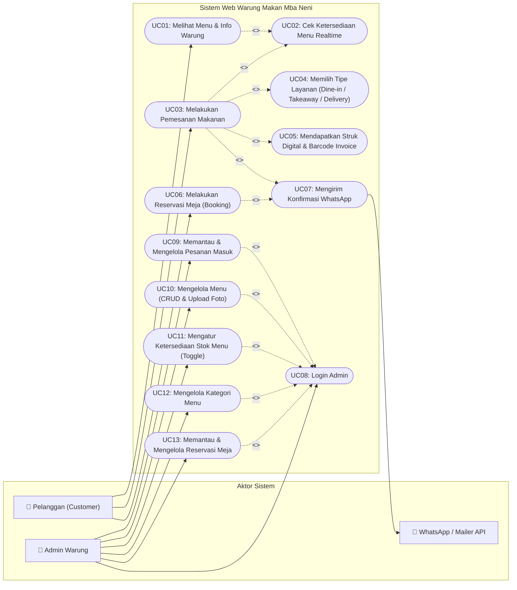

---

## 2. Class Diagram

Diagram ini merepresentasikan struktur data, entitas model Eloquent, controller, serta relasi asosiasi pada arsitektur Laravel 13 di proyek ini:
- `Category` memiliki relasi **1 ke banyak (*One to Many*)** dengan `MenuItem`.
- `Order` memiliki relasi **komposisi (*Composition*)** dengan `OrderItem`.
- `MenuItem` direferensikan pada pesanan melalui atribut `product_id`.
- `Booking` mencatat data reservasi meja dan status reservasi.

### Visualisasi Diagram (Mermaid)

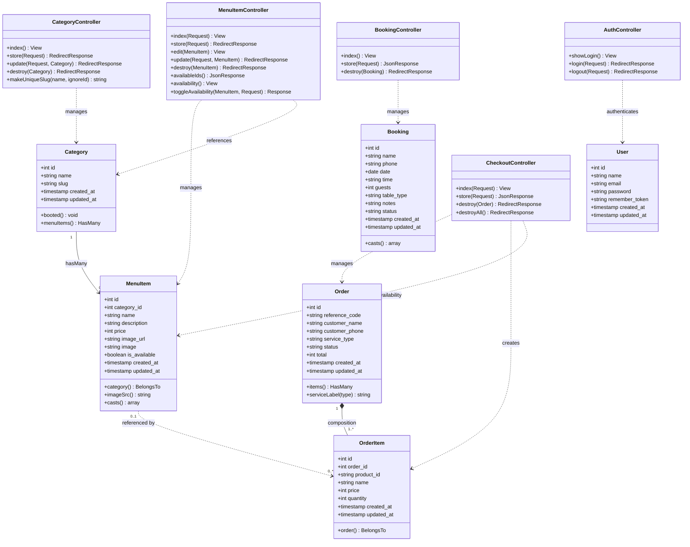

---

## 3. Sequence Diagram

### 3.1 Pemesanan Makanan Online (*Customer Checkout Flow*)

Diagram ini menggambarkan interaksi ketika pelanggan melakukan pesanan makanan dari halaman `/order`.

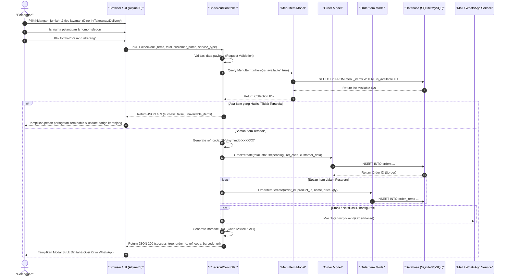

---

### 3.2 Reservasi Meja (*Table Booking Flow*)

Diagram interaksi saat pelanggan mengisi formulir booking meja di halaman `/booking`.

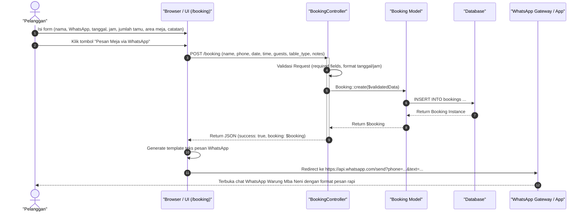

---

### 3.3 Toggle Ketersediaan Stok Menu (*Admin Realtime Availability*)

Diagram interaksi admin mengubah status ketersediaan menu secara instan tanpa reload halaman.

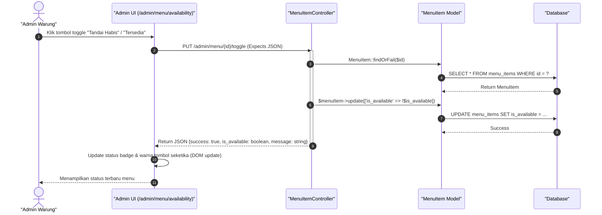

---

## 4. Activity Diagram

### 4.1 Alur Pemesanan Makanan Online (*Customer Flow*)

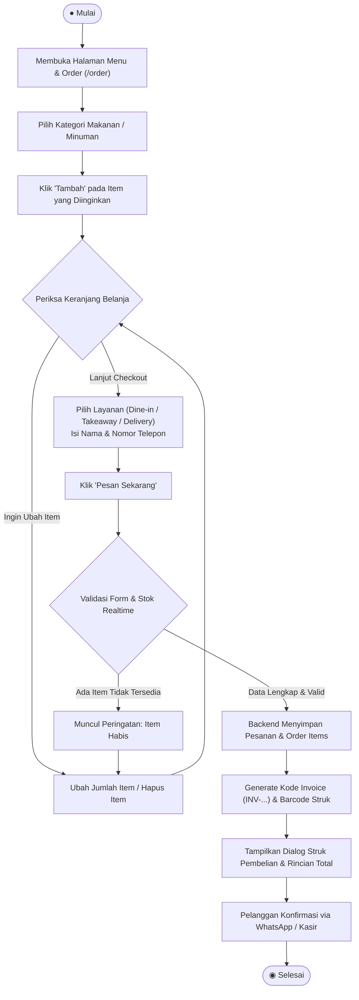

---

### 4.2 Alur Reservasi Meja (*Table Booking Flow*)

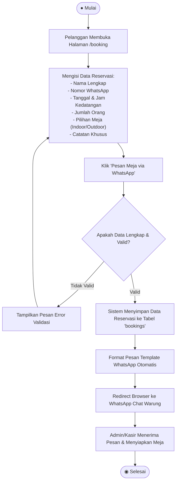

---

### 4.3 Alur Otentikasi & Manajemen Menu (*Admin Flow*)

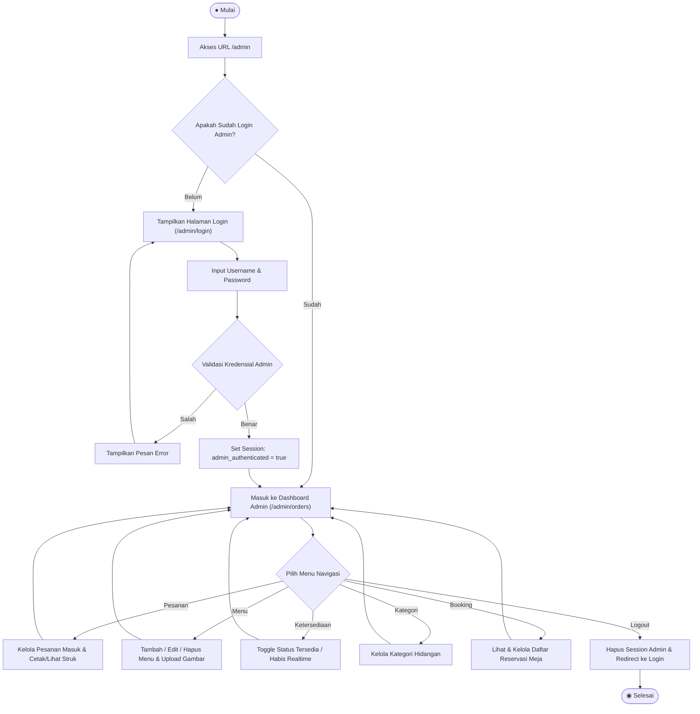

---

## 5. Kode PlantUML untuk Visual Paradigm Online Import

Untuk Anda yang ingin mengimpor diagram langsung ke [Visual Paradigm Online](https://online.visual-paradigm.com/) (Menu: **File** -> **Import** -> **PlantUML**):

### 5.1 PlantUML — Use Case Diagram
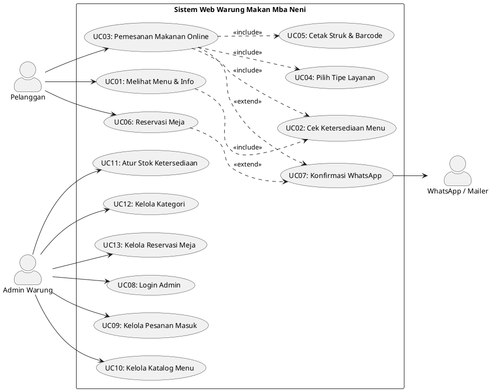

### 5.2 PlantUML — Class Diagram
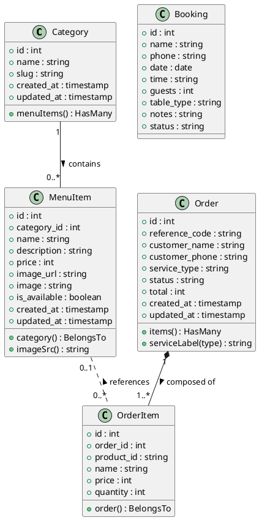

### 5.3 PlantUML — Sequence Diagram (Checkout)
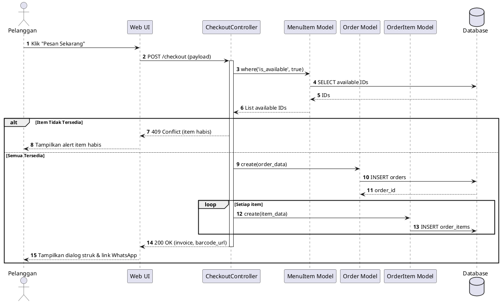
